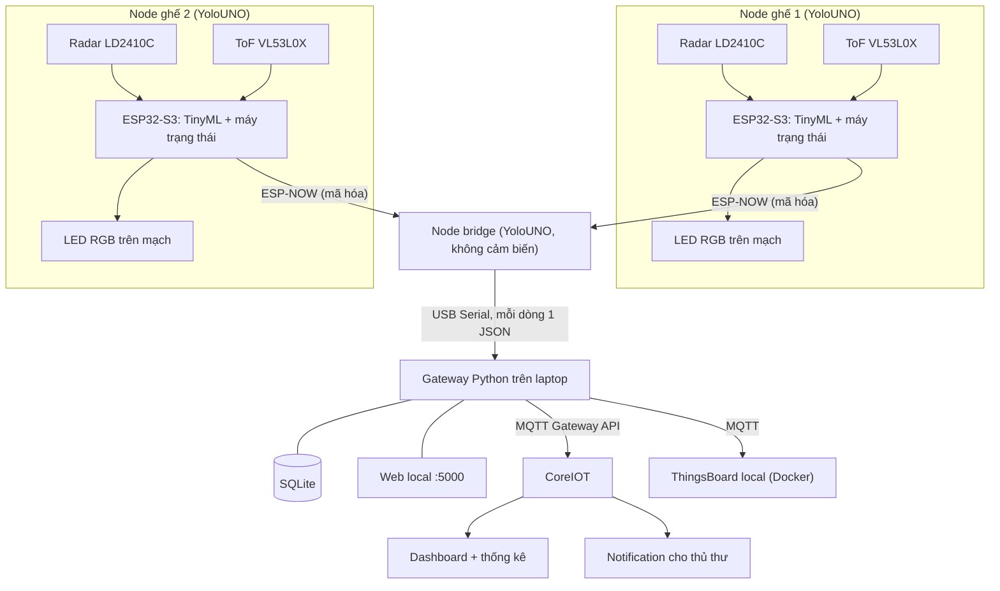

# Thiết kế hệ thống — Giám sát chỗ ngồi thư viện

> Cập nhật: 18/11/2026. Định dạng gói tin và tên key chi tiết nằm ở [`CONTRACT.md`](CONTRACT.md). Luồng dữ liệu chi tiết nằm ở [`DATAFLOW.md`](DATAFLOW.md).

## 1. Hệ thống làm gì

Mỗi chỗ ngồi có một node cảm biến. Node biết ghế đang **trống**, **có người**, hay **chỉ có đồ (balo) mà không có người**. Nếu một ghế ở trạng thái "chỉ có đồ" quá thời gian cho phép (`hogLimitSec`), hệ thống:

- tạo cảnh báo (alarm) trên CoreIOT,
- gửi thông báo cho thủ thư,
- cho đèn tại ghế nháy vàng để người xung quanh biết chỗ này sắp được giải phóng.

Dashboard hiển thị số chỗ trống theo thời gian thực và thống kê mức sử dụng từng ghế.

Hệ thống **không dùng camera**: chỉ dùng radar mmWave và cảm biến khoảng cách laser, không tạo ra hình ảnh nào.

## 2. Sơ đồ khối

Chiều mũi tên là chiều **dữ liệu đi lên**. Lệnh điều khiển (RPC) đi ngược lại trên cùng các chặng đó.

## 3. Phần cứng

### 3.1 Danh sách thiết bị (cấu hình demo)

| Thiết bị | SL | Gồm | Vai trò |
|---|---|---|---|
| Node ghế | 2 | YoloUNO + 1 radar HLK-LD2410C + 1 ToF VL53L0X (GY-530) | Đo, phân loại bằng TinyML, quyết định trạng thái ghế, điều khiển LED |
| Node bridge | 1 | YoloUNO (không gắn cảm biến) | Trạm thu phát: ESP-NOW ↔ USB Serial |
| Gateway | 1 | Laptop | Chạy gateway Python, AI, web local, ThingsBoard local |
| Cloud | — | CoreIOT (`app.coreiot.io`) | Lưu dữ liệu, rule chain, dashboard, notification, OTA |

Linh kiện cần mua cho cả hệ thống: 2 radar LD2410C, 2 ToF VL53L0X, 1 bó dây dupont đực–cái 20 cm. YoloUNO, cáp USB-C và nguồn 5V dùng đồ có sẵn.

### 3.2 Đấu nối mỗi node ghế

| Linh kiện | Chân linh kiện | Nối vào YoloUNO | Ghi chú |
|---|---|---|---|
| LD2410C | VCC, GND | 5V, GND | Dòng tiêu thụ khoảng 79 mA |
| | TX, RX | 2 GPIO làm RX1/TX1 (TX radar → RX mạch) | UART 256000 baud; số chân ghi trong `config.h` |
| VL53L0X | VIN, GND | 3.3V, GND | |
| | SDA, SCL | 2 GPIO I2C | Gọi `Wire.begin(SDA_PIN, SCL_PIN)` với số chân cụ thể |
| LED | — | NeoPixel có sẵn trên YoloUNO | Không cần mua thêm |

File board `yolo_uno.json` mượn variant `m5stack_atoms3`, nên **không dùng** các hằng `SDA`, `SCL`, `LED_BUILTIN` có sẵn mà luôn ghi số GPIO cụ thể theo sơ đồ chân YoloUNO.

### 3.3 Bố trí lắp đặt

- **Node ghế** gắn dưới mép bàn, ngay trước chỗ ngồi:
  - Radar chĩa vào vùng người ngồi, giới hạn tầm đo ở gate 1–2 (khoảng 0,75–1,5 m) bằng app HLKRadarTool.
  - ToF chiếu xuống mặt ghế. Ghế trống thì đo ra khoảng cách xa, có người hoặc balo thì đo ra khoảng cách ngắn hơn.
- **Hai chỗ ngồi cách nhau ít nhất 1 m** để radar không bắt nhầm người ngồi ghế bên.
- **Bridge** cắm USB vào laptop, đặt trong cùng phòng. Khoảng cách tới các node trong khoảng 10–30 m là an toàn cho ESP-NOW trong nhà.
- **Nguồn:** node ghế dùng sạc 5V hoặc sạc dự phòng; bridge lấy nguồn từ laptop.

## 4. Phần mềm từng tầng

| Tầng | Công nghệ | Thư mục | Chức năng chính |
|---|---|---|---|
| Node ghế | C++ / PlatformIO, Arduino framework, board `yolo_uno` | `firmware/node` | Đọc cảm biến 10 Hz, TinyML (Edge Impulse), máy trạng thái, LED, ESP-NOW, OTA |
| Bridge | C++ / PlatformIO | `firmware/bridge` | Nhận/gửi ESP-NOW, bảng `seat_id → MAC`, chuyển sang Serial JSON |
| Định dạng chung | C header | `firmware/common/seat_packet.h` | Struct `SeatPacket`, `CmdPacket` |
| Gateway | Python 3.11, paho-mqtt 2.x, pyserial, Flask, scikit-learn, SQLite | `gateway/` | Gateway MQTT API, RPC, lưu trữ, gửi bù, AI, web local, cảnh báo khi mất mạng |
| Cloud | CoreIOT (nền ThingsBoard) | `cloud/` (JSON export) | Device profile, rule chain `Seat Logic`, dashboard, notification, OTA |
| Cloud local | ThingsBoard CE trên Docker | — | Bản sao chạy song song (N07) |

## 5. Cách hoạt động (tóm tắt)

1. **Tại ghế:** node đọc radar và ToF 10 lần mỗi giây. TinyML phân loại cửa sổ 2 giây gần nhất thành `empty`, `person_still`, `person_move` hoặc `bag`. Node kết hợp với ToF để ra trạng thái ghế, rồi tự đổi màu LED.
2. **Gửi lên:** node gửi gói ESP-NOW (đã mã hóa) tới bridge mỗi khi trạng thái đổi, và gửi heartbeat mỗi 10 giây. Bridge chuyển gói thành một dòng JSON qua cáp USB.
3. **Gateway** đẩy dữ liệu lên CoreIOT bằng một kết nối MQTT duy nhất, đại diện cho mọi ghế. Đồng thời gateway lưu dữ liệu vào SQLite, tính số chỗ trống và tỉ lệ mất gói, chạy AI định kỳ, và phục vụ web local.
4. **CoreIOT:** rule chain `Seat Logic` so sánh `obj_secs` với `hogLimitSec`. Khi vượt ngưỡng: tạo alarm, gửi notification, và gửi lệnh `setWarning` ngược xuống ghế.
5. **Khi mất internet:** gateway tự áp dụng cùng quy tắc để vẫn cảnh báo được tại ghế.

Chi tiết từng bước xử lý: xem [`DATAFLOW.md`](DATAFLOW.md).

### 5.1 Trạng thái ghế và màu LED

| Trạng thái | Điều kiện | LED |
|---|---|---|
| `EMPTY` | ToF không thấy vật, không có người | Xanh lá |
| `OCCUPIED` | Có người (TinyML hoặc radar) | Đỏ |
| `OBJECT_ONLY` | ToF thấy vật nhưng không có người | Cam |
| Đang bị cảnh báo | Nhận lệnh `setWarning on` (từ rule chain, gateway, hoặc nút trên dashboard/web) | Vàng nháy |

## 6. Các cải tiến đã chốt

| Cải tiến | Gắn vào bước | Mô tả |
|---|---|---|
| LED 4 màu | A4 | Thêm màu cam cho `OBJECT_ONLY`, để người xung quanh thấy ngay ghế nào đang bị giữ bằng đồ |
| Mã hóa ESP-NOW | A5 | Dùng PMK chung và LMK cho từng peer, khóa đặt trong `secrets.h`. ESP-NOW mã hóa không nhận được gói từ thiết bị lạ, nên bridge phải khai sẵn danh sách MAC của các node |
| Gateway cảnh báo khi mất mạng | B4–B5 | Gateway lưu `hogLimitSec`; khi mất kết nối CoreIOT, gateway tự gửi `warn` xuống ghế khi `obj_secs` vượt ngưỡng |
| Dashboard thống kê | C2, B7 | Biểu đồ số chỗ trống theo giờ, tỉ lệ sử dụng từng ghế, số lần bị giữ chỗ trong ngày |

## 7. Ánh xạ thành phần và mục điểm

| Mã | Điểm | Thành phần |
|---|---|---|
| T06 | 1.5 | ESP-NOW node ↔ bridge |
| T14 | 2.0 | OTA firmware cho node |
| T04, T05 | 1.0 + 1.0 | TinyML trên node, train bằng Edge Impulse |
| T08 | 1.0 | Gateway Python trên laptop |
| T15 | 2.0 | Gateway MQTT API, device con đồng bộ với `Library-Gateway` |
| T09 | 1.0 | AI trên gateway (phát hiện giữ chỗ bất thường) |
| T10 | 1.0 | Web local trên gateway |
| T11 | 1.0 | Device profile + dashboard |
| T12 | 1.0 | Rule chain `Seat Logic` |
| T13 | 0.5 | Notification cho thủ thư |
| N07 | 1.0 (thưởng) | ThingsBoard local trên Docker |

Phần lõi (T06, T08, T15, T11, T12, T13, T14) = 9 điểm; phần bảo hiểm (T04, T05, T09, T10) = 4 điểm.

## 8. Hạn chế đã biết

- Người ngồi rất im lâu có thể bị nhận nhầm thành giữ chỗ; đồ để trên mặt bàn (ngoài vùng ToF) bị bỏ sót.
- Radar có thể bắt nhầm ghế bên nếu hai chỗ quá gần.
- Rule chain chạy trên cloud; khi mất mạng chỉ còn quy tắc dự phòng ở gateway.
- Laptop là điểm hỏng duy nhất của cả phòng.
- Hệ thống biết ghế bị giữ nhưng không biết ai giữ.
