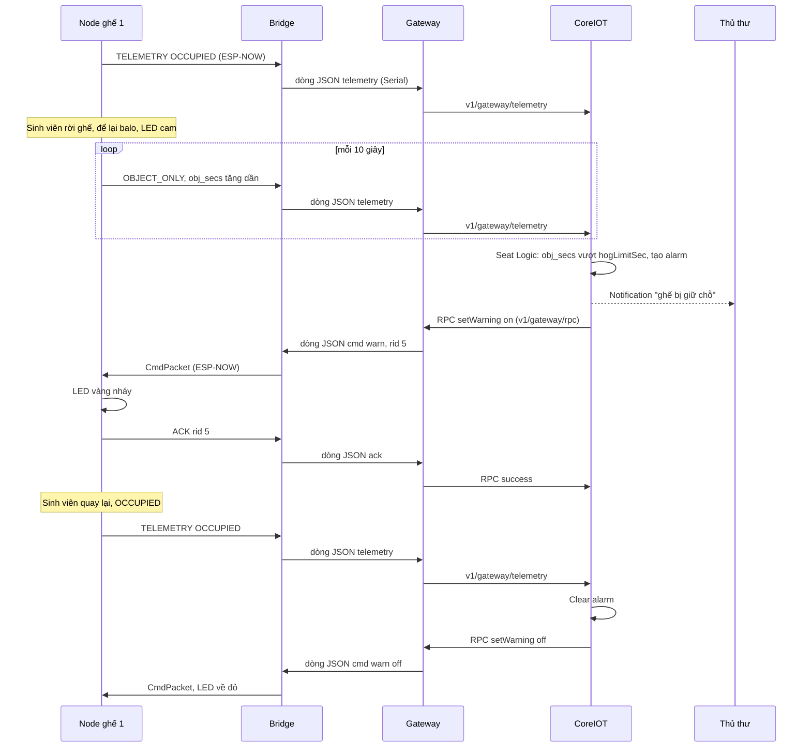

# Chuỗi công việc, luồng dữ liệu và xử lý dữ liệu

> Cập nhật: 18/11/2026. Tên trường, tên key và định dạng gói tin là theo [`CONTRACT.md`](CONTRACT.md); file này mô tả **ai xử lý gì, theo thứ tự nào**.

## 1. Tổng quan hai chiều

```text
ĐI LÊN:   cảm biến → node ghế → ESP-NOW → bridge → USB Serial → gateway → MQTT → CoreIOT
ĐI XUỐNG: rule chain / nút bấm → MQTT → gateway → USB Serial → bridge → ESP-NOW → node ghế (LED)
                                                                                └→ ACK đi ngược lên
```

| Chặng | Phương thức | Định dạng |
|---|---|---|
| Node → bridge | ESP-NOW unicast, kênh 1, mã hóa | Struct nhị phân `SeatPacket` (~15 byte) |
| Bridge → node | ESP-NOW unicast, mã hóa | Struct `CmdPacket` |
| Bridge ↔ gateway | USB Serial 115200 | Mỗi dòng 1 JSON; dòng bắt đầu bằng `#` là log, gateway bỏ qua |
| Gateway → CoreIOT | MQTT, token của `Library-Gateway` | `v1/gateway/connect`, `v1/gateway/telemetry` |
| CoreIOT → gateway | MQTT | `v1/gateway/rpc` |

## 2. Xử lý tại node ghế

```text
[1] Đọc cảm biến, 10 Hz
     radar: 9 năng lượng chuyển động + 9 năng lượng tĩnh (engineering mode)
     ToF:   khoảng cách (mm)
     → 1 mẫu = 19 số
[2] Cửa sổ trượt 20 mẫu (2 giây) = 380 số, cứ 0,5 giây chạy 1 lần
[3] TinyML → nhãn {empty, person_still, person_move, bag} + độ tin cậy
[4] Kết hợp luật:
     co_nguoi = (nhãn person_* VÀ tin cậy ≥ 70%) HOẶC radar thấy chuyển động
     co_vat   = tof_mm < TOF_OBJECT_MM
     → EMPTY / OCCUPIED / OBJECT_ONLY
[5] Chống nhiễu: trạng thái mới phải giữ liên tục 3 giây
[6] Máy trạng thái:
     - đổi màu LED ngay (xanh / đỏ / cam)
     - OBJECT_ONLY: đếm obj_secs; trạng thái khác: obj_secs = 0
[7] Gửi SeatPacket khi trạng thái đổi + heartbeat mỗi 10 giây (seq tăng 1 mỗi gói)
[8] Nhận CmdPacket:
     CMD_WARN on/off → bật/tắt nháy vàng, trả ACK cùng rid
     CMD_OTA         → trả ACK, vào WiFi, tải firmware từ CoreIOT, khởi động lại
```

Khởi động: node gửi `MSG_HELLO` (kèm phiên bản firmware) trước khi gửi telemetry.

## 3. Xử lý tại bridge

1. Khởi động: cố định kênh 1, nạp danh sách MAC của các node làm peer **có mã hóa** (LMK), in `# MAC: ...` để kiểm tra.
2. **Callback nhận ESP-NOW:** chỉ copy gói vào hàng đợi, không in Serial trong callback.
3. **`loop()`:** lấy gói khỏi hàng đợi, cập nhật bảng `seat_id → MAC`, gắn RSSI (nếu core hỗ trợ), in 1 dòng JSON `hello` / `telemetry` / `ack`.
4. **Đọc Serial:** parse dòng `{"type":"cmd",...}`, tra MAC của ghế, gửi `CmdPacket`.

## 4. Xử lý tại gateway (laptop)

| Thành phần | File | Việc làm |
|---|---|---|
| Đọc bridge | `serial_link.py` | Mở `SERIAL_URL` (COM thật hoặc `socket://` của bridge giả), đọc từng dòng JSON, tự mở lại khi mất kết nối |
| Kết nối CoreIOT | `tb_client.py` | MQTT bằng token gateway; subscribe `v1/gateway/rpc`; khai báo lại device con sau khi kết nối lại |
| Vòng lặp chính | `main.py` | Gặp `hello` → `v1/gateway/connect` + gửi `current_fw_version`. Gặp `telemetry` → gắn `ts` lúc nhận, gửi lên `v1/gateway/telemetry`, theo dõi `seq`, cập nhật `free_seats` của `Room-A`. Mỗi 60 giây gửi `loss_pct` |
| Lưu trữ, gửi bù | `store.py` | Bảng `readings` (mọi gói) và `outbox` (bản tin chưa gửi được); gửi lại `outbox` khi có mạng |
| RPC | `main.py` | `setWarning` → `cmd: warn`, `enterOta` → `cmd: ota`; chờ ACK tối đa 5 giây rồi trả `success` true/false |
| Cảnh báo khi mất mạng | `main.py` | Khi MQTT mất kết nối: nếu `obj_secs ≥ hogLimitSec` (giá trị lưu gần nhất) thì tự gửi `warn on`; ghế về trạng thái khác thì gửi `warn off`. Khi có mạng lại, rule chain tiếp quản |
| AI | `ai_job.py` | Mỗi 5 phút đọc SQLite, tính đặc trưng 30 phút gần nhất của từng ghế, chạy `IsolationForest`, gửi `hog_score`, `hog_anomaly` lên `Room-A` |
| Thống kê | `ai_job.py` | Tính tỉ lệ sử dụng từng ghế và số lần bị giữ chỗ trong ngày cho dashboard thống kê |
| Web local | `web/app.py` | Flask :5000; `/api/state` trả trạng thái, `/api/cmd` ghi lệnh thẳng xuống Serial (không qua CoreIOT) |
| Bridge giả | `fake_bridge.py` | TCP :7000, giả 3 ghế theo kịch bản cố định để test khi chưa có phần cứng |

## 5. Xử lý tại CoreIOT

1. Telemetry vào device con (`Seat-01..`, `Room-A`) → rule chain của profile `library-seat` là `Seat Logic`.
2. **`Seat Logic`** (bản sao của Root Rule Chain, giữ nguyên node save timeseries):
   - Originator attributes: lấy `hogLimitSec` vào metadata.
   - Script filter `Is hogging?`: `state == 'OBJECT_ONLY' && obj_secs >= hogLimitSec`.
     - True → Create alarm `Seat hogging` → (Created) → RPC `setWarning {on: true}`.
     - False → Script filter `Ended?`: `state != 'OBJECT_ONLY'` → Clear alarm → (Cleared) → RPC `setWarning {on: false}`.
3. **Notification center:** rule trigger Alarm `Seat hogging`, Created → thông báo cho nhóm `Thủ thư` (web + app điện thoại).
4. **Dashboard:** bảng trạng thái ghế, số chỗ trống, biểu đồ `obj_secs`, bảng alarm, nút RPC, `hog_anomaly`, thống kê sử dụng theo giờ và theo ghế.
5. **Inactivity:** `inactivityTimeout = 30000` ms → ghế không gửi gì trong 30 giây bị đánh dấu inactive.

## 6. Kịch bản đầu cuối: giữ chỗ và cảnh báo



## 7. Luồng OTA

1. Upload `firmware.bin` mới lên CoreIOT (OTA updates), gán cho ghế.
2. Bấm `enterOta` trên dashboard → lệnh đi xuống như mục 6.
3. Node rời ESP-NOW, vào WiFi, kết nối thẳng CoreIOT bằng token riêng của ghế (không qua bridge), tải firmware theo từng phần, kiểm checksum, ghi phân vùng OTA, khởi động lại.
4. Node gửi `HELLO` với phiên bản mới → gateway gửi `current_fw_version` → dashboard hiển thị.

## 8. Khi có sự cố

| Sự cố | Hệ thống phản ứng |
|---|---|
| Mất internet | Node, bridge, LED, web local vẫn chạy. Gateway lưu vào `outbox`, gửi bù khi có mạng, và tự cảnh báo giữ chỗ bằng quy tắc dự phòng |
| Mất gói ESP-NOW | Gateway phát hiện qua `seq` nhảy cóc, gửi `loss_pct`. Heartbeat 10 giây làm trạng thái đúng lại trong tối đa 10 giây |
| Node mất nguồn | Sau 30 giây CoreIOT đánh dấu inactive |
| Gateway khởi động sau bridge | Gặp telemetry của ghế chưa khai báo thì tự gọi `connect` trước |
| RPC không có ACK | Sau 5 giây gateway trả `success: false` |

## 9. Bảng thời gian

| Thông số | Giá trị |
|---|---|
| Tần số đọc cảm biến | 10 Hz |
| Cửa sổ TinyML / nhịp suy luận | 2 giây / 0,5 giây |
| Debounce trạng thái | 3 giây |
| Heartbeat | 10 giây |
| Ngưỡng giữ chỗ `hogLimitSec` | 120 giây (demo), 1200 giây (thực tế) |
| Cửa sổ tính `loss_pct` | 60 giây |
| Chu kỳ AI gateway | 5 phút |
| Inactivity timeout | 30 giây |
| Timeout chờ ACK của RPC | 5 giây |
